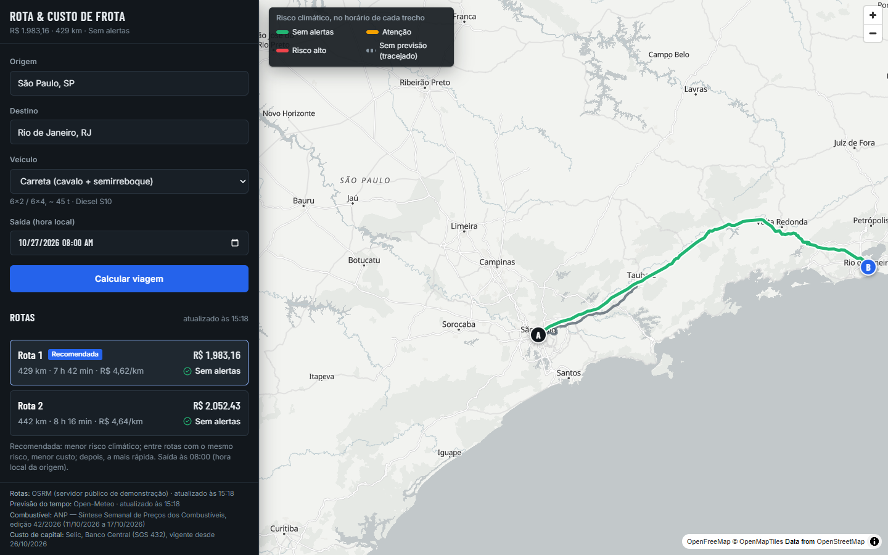
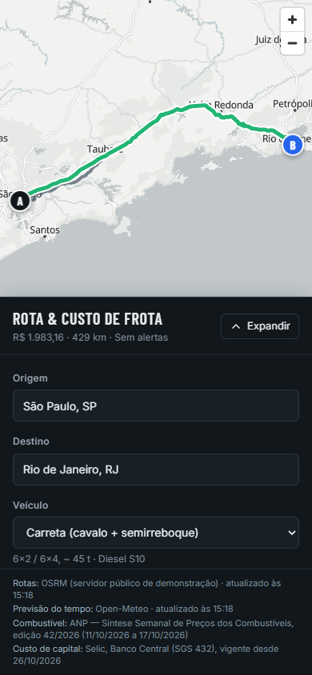
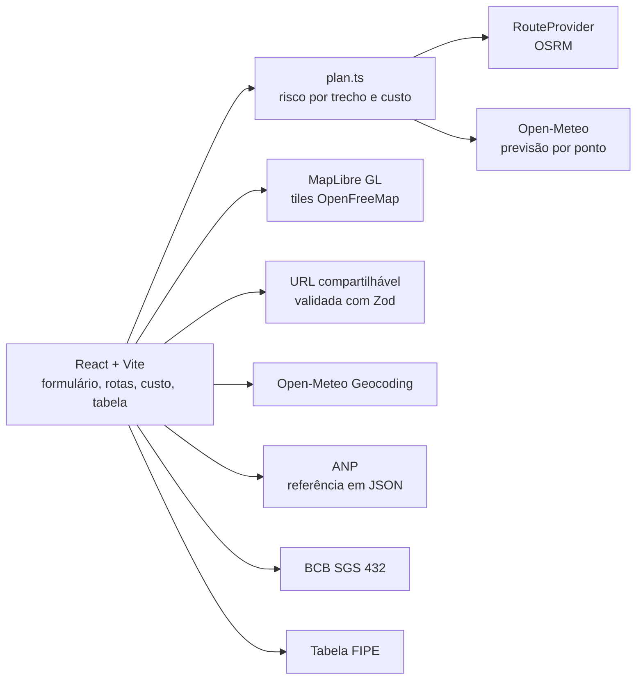

# Rota & Custo de Frota

> Trip planner for fleets: compares up to three routes, paints each road segment by the weather at the hour the vehicle will be there, and estimates the trip cost per km.
> Built only on public APIs, with no keys and no backend. Runs entirely in the browser.
> Planejador de viagem para frotas, com clima no horário de cada trecho e custo por km, só com dados públicos.



## O que é

Planejador de viagem de frota pelo Brasil. Você escolhe origem, destino, veículo e horário de saída. O app mostra:

- até três rotas rodoviárias, com a recomendada destacada e o critério explicado na tela;
- o **risco climático em cada trecho**, no horário em que o veículo estará ali (não no horário atual);
- o **custo da viagem** em combustível, manutenção, motorista, depreciação, custo de capital e pedágio, com custo por km;
- o estado da tela na URL, para compartilhar a conversa com quem precisa decidir.

## Por que importa

Um planejador comum entrega distância e tempo. Quem decide um frete também precisa saber se o caminhão vai pegar chuva forte
entre 14h e 16h, e quanto custa cada alternativa. Este projeto cruza trajeto (OSRM), previsão do tempo por horário
(Open-Meteo), preço de combustível (ANP) e economia do veículo (FIPE e Selic) em uma só tela, com premissas visíveis e editáveis.

## Mobile



## Arquitetura



Lógica de domínio em `src/lib` (risco, custo, recomendação, tempo, geometria), com testes. Serviços externos em
`src/services`, cada resposta validada antes do uso. A interface só consome o resultado validado.

## Fontes de dados

| Dado | Fonte | Chave | Limites e atribuição |
|---|---|---|---|
| Rotas | [OSRM](https://project-osrm.org/) (servidor público de demonstração) | não | Sem SLA; pode limitar uso. Dados © OpenStreetMap |
| Previsão do tempo | [Open-Meteo](https://open-meteo.com/) | não | Até 16 dias; uso não comercial gratuito |
| Busca de cidades | [Open-Meteo Geocoding](https://open-meteo.com/) | não | Só Brasil |
| Combustível | [ANP, Síntese Semanal de Preços](https://www.gov.br/anp/pt-br/assuntos/precos-e-defesa-da-concorrencia/precos/arq-sintese-semanal) (edição 42/2026) | não | Revenda na capital; transcrição manual, conferida contra o PDF |
| Custo de capital | [Banco Central, SGS 432 (meta Selic)](https://www.bcb.gov.br/) | não | Último valor com vigência até hoje |
| Valor do veículo | [Tabela FIPE](https://veiculos.fipe.org.br/), pela API pública `fipe.parallelum.com.br` | não | 500 consultas/dia por IP |
| Mapa | [OpenFreeMap](https://openfreemap.org/) (estilo positron) | não | Dados © OpenStreetMap contributors |

Pedágio não tem fonte pública gratuita confiável: é um campo manual, zero por padrão.

## Como rodar

Requisitos: Node 24 (ver `.nvmrc`).

```bash
npm ci
npm run dev        # desenvolvimento, http://localhost:5173
npm run build      # checagem de tipos e build de produção em dist/
npm run preview    # serve o build em http://localhost:4173
```

Outros scripts: `npm run lint`, `npm run typecheck`, `npm test`.

## Decisões de segurança

- Sem backend, sem segredo e sem chave de API. Nada sensível no front-end.
- CSP no build de produção, com `connect-src` restrito aos hosts exatos usados. Sem CDN de script ou fonte em runtime; fontes self-hosted.
- Sem `dangerouslySetInnerHTML`: todo texto vindo de API é renderizado como texto.
- Dados externos validados com Zod; item inválido é descartado e a seção degrada com mensagem clara.
- URL compartilhável validada: coordenada, fuso, UF e veículo passam por schema antes de virar estado.
- Workflows com `permissions` mínimas; Dependabot para npm e GitHub Actions.

Detalhes e alternativas descartadas estão em [`docs/design.md`](docs/design.md).

## Limitações conhecidas

- O risco é **apoio à decisão**, não alerta meteorológico oficial. Os limiares estão em `src/lib/risk.ts`.
- Previsão só até 16 dias. Além disso o trecho aparece como "sem previsão".
- Preço de combustível é da capital, semanal e transcrito à mão; não reflete o posto da rota.
- Consumo, manutenção, depreciação e motorista são **premissas editáveis**, não dados oficiais.
- Premissas editadas não viajam na URL: quem abre um link compartilhado vê os valores padrão.
- Serviço de rotas é um servidor público de demonstração, sem garantia de disponibilidade.

## Roadmap

- Trocar o OSRM demo por um provedor com SLA atrás da mesma interface `RouteProvider`.
- Incluir as premissas editadas na URL, se o compartilhamento se mostrar útil.
- Atualização automatizada da referência ANP quando houver uma fonte estável.

## Licença

MIT. Copyright (c) 2026 Herick Silva. Veja [LICENSE](LICENSE).
